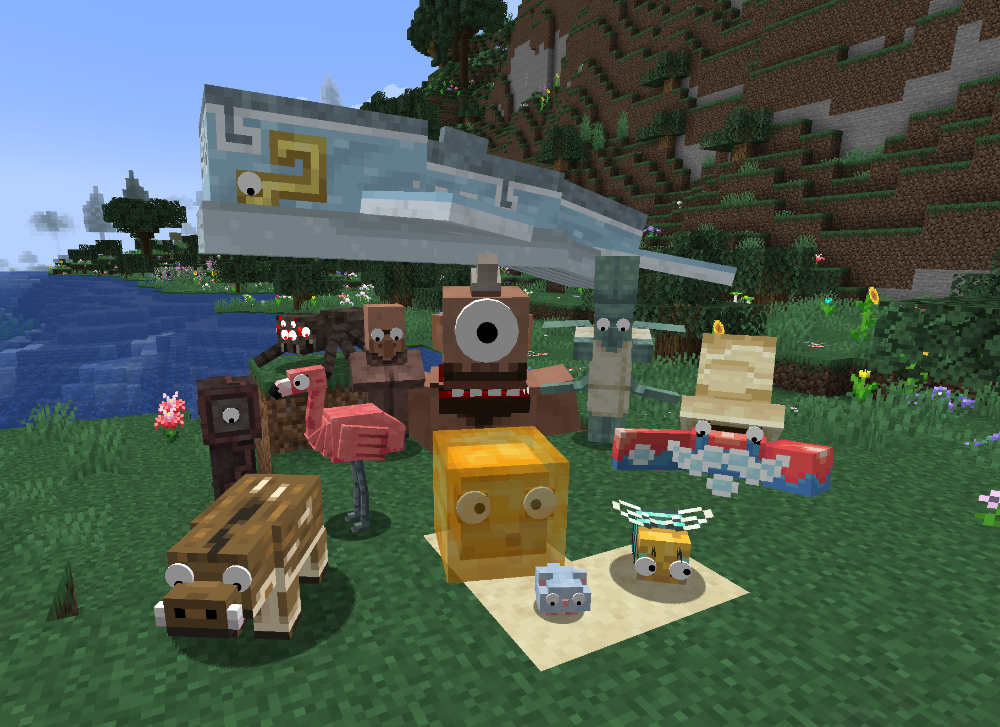

# Some Googly Eyes

A complete rewrite and expansion of [iChun's Googly Eyes](https://www.curseforge.com/minecraft/mc-mods/googlyeyes).

Now with multiple behaviors: mobs blink, stare, go cross-eyed, side-eye you, and more.

Eyes are a collectible resource: harvest them, recolor them, set them in a slimeball, and stick them on other mobs, or yourself.

**0.8.3 The More Update:**

- **Not just mobs: Item frame, skull, head, and boat support.** Eyed mobs drop eyed heads. Add eyes to skulls and boats. Supports [Heads by Mrbysco](https://www.curseforge.com/minecraft/mc-mods/heads).
- **More versions.** Added support for 1.21.8/11 and all of 26.\*.
- **More mods.** Added Alex’s Caves, Ancient Warfare 2: Remastered, Animania Reborn, Ars Magica: Legacy, Creatures and Beasts, Enemy Expansion, Guard Villagers, Iron’s Spells ’n Spellbooks, Just Another Witchery Remake, Legendary Monsters, MobZ, Mutants and Zombies, Realm RPG: Dragon Wyrms, Realm RPG: Imps & Demons, Species, Spore, Thaumaturge, The Aether II, The Graveyard, The Undergarden, Undermod, Villager Recruits, and Zombie Extreme.

Includes attachment support for GeckoLib-, Citadel-, LLibrary, and Uranus-based mobs. Datapack-aware: in-game configuration tool for adding and configuring eyes and exporting as a datapack.

 

## Getting eyes

**Dispatch the mob with a direct shears blow**: there's a chance to drop a googly eye.

**Find the Optometrist enchantment**: put it on shears; then right-clicking an eyed mob/head/boat plucks the eye off without harming the mob.

**Customize it in a crafting grid**: eye + any dye sets the iris color, + glowstone dust makes it visible in darkness, + redstone turns glow off, + cobweb strips it back to default.

**Set it in slime**: googly eye + slimeball → a **Slimy Eye**, which inherits the eye's colors.

**Apply it**: right-click a mob/head/boat with the slimy eye to give it eyes, or sneak and use it to grow your own. Each application picks the mob's eye arrangement anew. A mob that already has eyes refuses it. Pluck them off first to restyle.

**Decorate with heads**: placed mob heads can have googly eyes too. An eyed skeleton's dropped skull keeps its eyes; a slimy eye gives any skeleton, wither skeleton, zombie, creeper, piglin, or player head a pair, and Optometrist shears pluck them back off. Eyed heads keep their eyes when broken and placed again. With the Heads mod installed (1.20.1 on Forge, 1.21.1, 1.21.11, and 26.1.2 on NeoForge), most of its mob heads work the same way.

## Eye potential

Don't waste your slimy eye: hold an eye and sneak while targeting a mob to see whether that mob can have eyes at all.

## Configuration

- **Server settings** (`<world>/serverconfig/somegoogly-server.toml`; on NeoForge 26.3, `config/somegoogly-server.toml`, which `<world>/syncedconfig/somegoogly-server.toml` overrides): global and per-mob spawn chances, harvest chance, and which eye expressions play and how often.
- **Client settings** (`config/somegoogly-client.toml`): turn eye rendering off entirely, or hide it for specific mobs or whole mods; purely visual, per-player.

See [docs/configuration.md](docs/configuration.md) for the full reference.

## Pack and mod authors

Eye placements are ordinary datapack JSON. There's also an in-game authoring tool that lets you place, aim, and scale eyes on a live mob (operators in creative mode) and export the result as datapack files.

- [docs/datapack-format.md](docs/datapack-format.md) — the eye definition format
- [docs/picker.md](docs/picker.md) — the in-game authoring workflow and `/sg` commands

## Compatibility

The eye placing system supports vanilla models as well as GeckoLib-, Citadel-, and Uranus-based models, including those that use legacy LLibrary code.

Ships with predefined eye configs for:

| | | |
|---|---|---|
| Minecraft | Friends & Foes | Realm RPG: Imps & Demons |
| Abnormals Autumnity | Guard Villagers | Regions Unexplored |
| Abnormals Caverns & Chasms | Hamsters Plus Lite | Rotten Creatures |
| Abnormals Environmental | Ice and Fire / Community Edition | Shiny |
| Abnormals Upgrade Aquatic | Illager Invasion | Simply Cats |
| Ad Astra | Immersive Engineering | Species |
| Adorable Hamster Pets | Iron's Spells 'n Spellbooks | Spore |
| AdventureZ | Just Another Witchery Remake | Supplementaries |
| Alex's Caves | Legendary Monsters | Sushi Go Crafting |
| Alex's Mobs | Let's Do Alpine Whispers | Thaumaturge |
| Ancient Warfare 2: Remastered | Let's Do Brewery | The Aether |
| Animania Reborn | Let's Do Furniture | The Aether II |
| Ars Elemental | Let's Do Meadow | The Bumblezone |
| Ars Magica: Legacy | Let's Do Vinery | The Graveyard |
| Ars Nouveau | Living Things | The Undergarden |
| Artifacts | MmmMmmMmmMmm | Tiny Skeletons |
| Creatures and Beasts | MobZ | Twilight Forest |
| Critters and Companions | Mowzie's Mobs | Undermod |
| Ecologics | Mutants and Zombies | Variants & Ventures |
| Enemy Expansion | Naturalist | Villager Recruits |
| EvilCraft | Occultism | WilderNature |
| Exotic Birds | Oh The Biomes We've Gone | Zombie Extreme |
| Farming for Blockheads | Productive Bees |  |
| Forbidden Arcanus | Realm RPG: Dragon Wyrms |  |

Use the in-game eye config system to generate custom datapacks. Submissions for future releases appreciated! Find a mob that doesn't behave? [Open an issue](../../issues).

## Credits and license

A port of iChun's **Googly Eyes**, rebuilt for Minecraft 1.20.1 through 26.3 with new physics, behaviors, and more.

License: [**GPL-3.0**](LICENSE).
