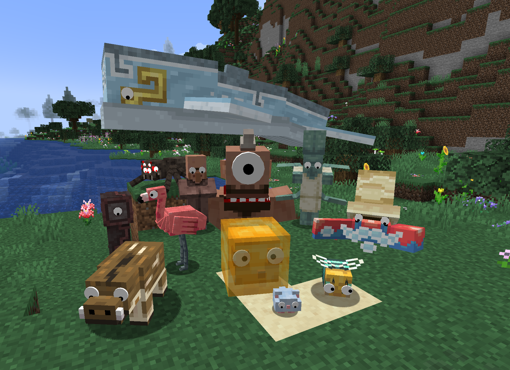

# Some Googly Eyes

A complete rewrite and expansion of [iChun's Googly Eyes](https://www.curseforge.com/minecraft/mc-mods/googlyeyes). (Also look to [Regoogly eyes](https://www.curseforge.com/minecraft/mc-mods/regoogly-eyes) by EmeryTheModder if you want a pure port of the original.)

Now with multiple behaviors: mobs blink, stare, go cross-eyed, side-eye you, and more.

Eyes are a collectible resource: harvest them, recolor them, set them in a slimeball and stick them on other mobs, or yourself.

Includes attachment support for GeckoLib-, Citadel-, and Uranus-based mobs, as well as those using LLibrary. Datapack-aware: In-game configuration tool for adding and configuring eyes and exporting as a datapack.

 

## Getting eyes

**Dispatch the mob with a direct shears blow**: there's a chance to drop a googly eye.

**Find the Optometrist enchantment**: Put it on shears; then right-clicking an eyed mob plucks the eye off without harming the mob.

**Customize it in a crafting grid**: eye + any dye sets the iris color, + glowstone dust makes it visible in darkness, + redstone turns glow off, + cobweb strips it back to default.

**Set it in slime**: googly eye + slimeball → a **Slimy Eye**, which inherits the eye's colors.

**Apply it**: right-click a mob with the slimy eye to give it eyes, or sneak and use it to grow your own. Each application picks the mob's eye arrangement anew. A mob that already has eyes refuses it. Pluck them off first to restyle.

**Decorate with heads**: placed mob heads can have googly eyes too. An eyed skeleton's dropped skull keeps its eyes; a slimy eye gives any skeleton, wither skeleton, zombie, creeper, piglin, or player head a pair, and Optometrist shears pluck them back off. Eyed heads keep their eyes when broken and placed again. With the Heads mod installed on Forge, most of its mob heads work the same way.

## Eye potential
Don't waste your slimy eye: hold an eye and sneak while targeting a mob to see whether that mob can have eyes at all.

## Configuration

- **Server settings** (`<world>/serverconfig/somegoogly-server.toml`): global and per-mob spawn chances, harvest chance, and which eye expressions play and how often.
- **Client settings** (`config/somegoogly-client.toml`): turn eye rendering off entirely, or hide it for specific mobs or whole mods; purely visual, per-player.

See [docs/configuration.md](docs/configuration.md) for the full reference.

## Pack and mod authors

Eye placements are ordinary datapack JSON. There's also an in-game authoring tool that lets you place, aim, and scale eyes on a live mob (operators in creative mode) and export the result as datapack files.

- [docs/datapack-format.md](docs/datapack-format.md) — the eye definition format
- [docs/picker.md](docs/picker.md) — the in-game authoring workflow and `/sg` commands

## Compatibility

The eye placing system supports vanilla models as well as GeckoLib-, Citadel-, and Uranus-based models, including those that use legacy LLibrary code.

Ships with predefined eye configs for:

| | | |
|---|---|---|
| Minecraft | Farming for Blockheads | Occultism |
| Abnormals Autumnity | Forbidden Arcanus | Oh The Biomes We've Gone |
| Abnormals Caverns & Chasms | Friends & Foes | Productive Bees |
| Abnormals Environmental | Hamsters Plus Lite | Regions Unexplored |
| Abnormals Upgrade Aquatic | Ice and Fire Community Edition | Rotten Creatures |
| Ad Astra | Illager Invasion | Shiny |
| Adorable Hamster Pets | Immersive Engineering | Simply Cats |
| AdventureZ | Let's Do Alpine Whispers | Supplementaries |
| Alex's Mobs | Let's Do Brewery | Sushi Go Crafting |
| Ars Elemental | Let's Do Furniture | The Aether |
| Ars Nouveau | Let's Do Meadow | The Bumblezone |
| Artifacts | Let's Do Vinery | Tiny Skeletons |
| Critters and Companions | Living Things | Twilight Forest |
| Ecologics | MmmMmmMmmMmm | Variants & Ventures |
| EvilCraft | Mowzie's Mobs | WilderNature |
| Exotic Birds | Naturalist |  |

Use the in-game eye config system to generate custom datapacks. Submissions for future releases appreciated! Find a mob that doesn't behave? [Open an issue](../../issues).

Available for Fabric, NeoForge, and Forge on Minecraft 1.21.4.

## Credits and license

A port of iChun's **Googly Eyes**, rebuilt for 1.21.4 with new physics, behaviors, and more.

License: [**GPL-3.0**](LICENSE).
